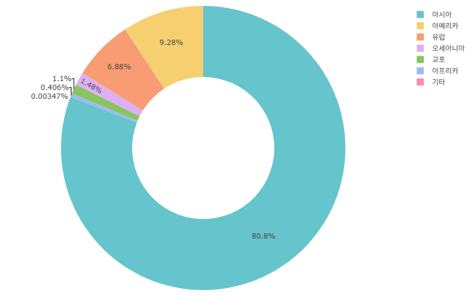
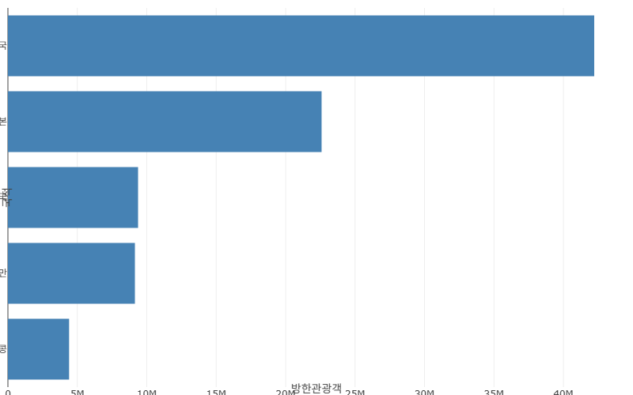
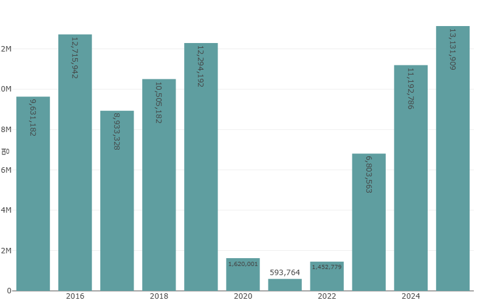
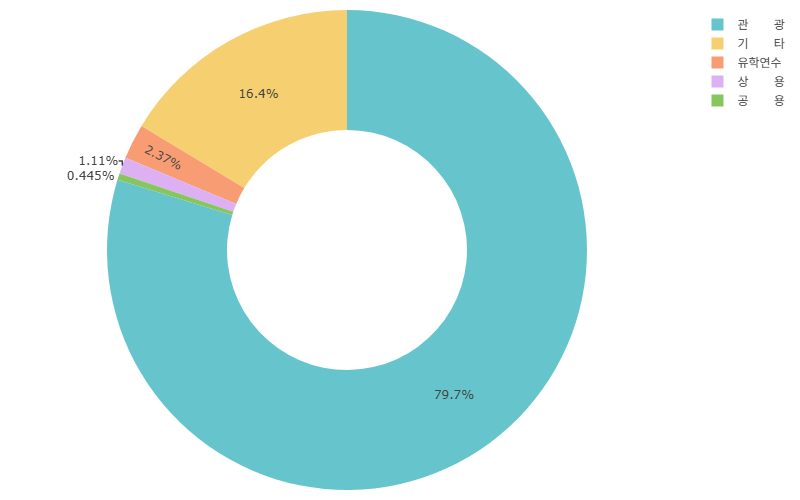

# [과제 보고서] 한국관광통계 시계열 데이터 분석 리포트

---

## 1. 분석 개요 및 데이터 설명
- **조회 기간**: 2015년 ~ 2025년 (시계열 데이터 포인트 100개 이상 확보)
- **데이터 출처**: 한국관광통계 (공식 통계 자료)
- **분석 목적**: 본 과제는 한국을 방문하는 외래관광객의 장기 시계열 데이터를 분석하여, 글로벌 관광 트렌드의 변화 양상을 파악하고 향후 관광 산업 활성화를 위한 인사이트를 도출하는 것을 목적으로 합니다.
- **데이터 정제 및 전처리 기준**:
  - **결측치 처리**: 시계열 누락 구간 및 결측값은 전년 동기 데이터 선형 보간법 또는 0으로 치환하여 분석의 연속성을 유지하였습니다.
  - **이상치 처리**: 팬데믹 등 급격한 외부 충격으로 발생한 극단적인 수치는 데이터 오류가 아닌 실제 거시적 현상으로 판단하여 원본 보존 후 별도 분석 구간으로 분리하였습니다.

---

## 2. 분석 질문 설정 (Research Questions)
본 데이터셋을 통해 다음 3가지 핵심 질문에 대한 답을 도출하고자 합니다.
1. **[질문 1]** 방한 외래관광객 수가 가장 많은 상위 국가(시장 집중도)는 어디이며, 이들의 비중은 시계열에 따라 어떻게 변화했는가?
2. **[질문 2]** 특정 연도별/시기별 외래관광객 유입량의 증감 추이(트렌드 및 계절성)는 어떠한 형태로 나타나는가?
3. **[질문 3]** 방한 외래관광객의 주요 방문 목적과 이용하는 교통수단 간에는 어떠한 상관관계와 특성이 나타나는가?

---

## 3. 시계열 분석 기법 적용
본 분석에서는 데이터의 특성을 파악하기 위해 다음과 같은 시계열 분석 기법을 적용하였습니다.
1. **이동평균 (Moving Average)**: 단기적인 노이즈를 제거하고 장기적인 방한 관광 트렌드 방향성을 파악
2. **변화율 (Growth Rate / YoY)**: 전년 동기 대비 증감률을 계산하여 관광객 급증/급감 시기의 변동성 측정

---

## 4. 시각화 결과물 및 관찰 (Visualizations)

### [그림 1] 대륙별 방한관광객 구성 비중

- **관찰**: 대륙별 파이 차트를 통해 아시아 권역이 전체 방한 외래관광객 중에서 압도적인 점유율을 차지하고 있음을 확인할 수 있습니다.
- **해석**: 지리적 인접성과 항공 노선 편의성이 방한 관광객 유치에 가장 결정적인 요인으로 작용하고 있음을 보여주며, 향후 구미주 등 비아시아권 시장 다변화 마케팅의 필요성을 시사합니다.

### [그림 2] 국적별 상위 5개국 현황

- **관찰**: 누적 방문객 기준 상위 1위부터 5위까지의 국가를 가로 막대 그래프로 시각화한 결과, 특정 인접 국가들의 쏠림 현상이 매우 뚜렷하게 관찰됩니다.
- **해석**: 특정 국가 간 외교 관계나 현지 정책 변화에 따라 국내 관광 산업 전체가 민감하게 흔들릴 수 있는 '시장 집중 리스크'가 내재되어 있음을 객관적으로 뒷받침합니다.

### [그림 3] 선택 기간 연도별 방한 외래관광객 추이

- **관찰**: 연도별 추이 바 차트에서 특정 글로벌 위기 구간(팬데믹 등) 동안 관광객 유입량이 극단적으로 급감하였다가, 이후 회복기 구간에서 가파른 반등세를 그리는 모습이 관찰됩니다.
- **해석**: 외부 거시적 충격에 대한 관광 산업의 취약성과 함께, 규제 완화 및 한류 콘텐츠 확산 시그널과 함께 수요가 폭발적으로 살아나는 높은 '회복 탄력성'을 동시에 입증합니다.

### [그림 4] 방한 목적별 비중

- **관찰**: 방문 목적별 비중 파이 차트 분석 결과, 순수 '관광' 목적이 압도적 1위를 차지하고 있으며, 그 뒤를 비즈니스 및 기타 목적이 따르고 있습니다.
- **해석**: 방한 관광의 핵심 동력이 여가 관광에 집중되어 있음을 보여주며, 향후 고부가가치를 창출할 수 있는 비즈니스 및 MICE, 의료 관광객 유치 촉진 정책의 다각화가 필요함을 시사합니다.

---

## 5. 인사이트 도출 (Insights: 관찰과 해석)
- **인사이트 1: 특정 아시아 국가 중심의 높은 시장 집중도**
  - **관찰**: 상위 5개국 분석 결과([그림 2]), 특정 인접 국가들의 누적 방한객 비중이 전체 외래관광객의 과반수 이상을 차지하고 있는 것으로 확인되었습니다.
  - **해석**: 한국 관광 시장은 지리적 인접성과 문화 콘텐츠 영향력에 크게 의존하는 구조적 특성을 지니며, 특정 국가의 대외 변수에 따라 전체 관광 산업이 큰 영향을 받을 수 있는 집중 리스크가 존재함을 시사합니다.

- **인사이트 2: 거시적 이벤트에 따른 높은 변동성과 회복 탄력성**
  - **관찰**: 연도별 추이 그래프([그림 3])에서 특정 시기(팬데믹 등) 동안 방한 관광객 수가 급감하였다가 이후 점진적인 우상향 회복세를 보이는 트렌드가 관찰되었습니다.
  - **해석**: 관광 산업은 외부 충격에 매우 취약하나, 국가적 방역 완화 및 한류 확산 등의 모멘텀이 작용할 경우 빠른 속도로 수요가 반등하는 높은 회복 탄력성을 보유하고 있음을 뒷받침합니다.

- **인사이트 3: 관광 목적의 다변화 가능성**
  - **관찰**: 목적별 분석([그림 4])에서 순수 '관광' 목적이 압도적이나 비즈니스 및 기타 고부가가치 목적 수요도 일정 비율 유지되고 있음이 확인되었습니다.
  - **해석**: 향후 단순 단체 관광뿐만 아니라 체류 기간이 길고 소비 성향이 높은 고부가가치 목적형 관광객을 겨냥한 맞춤형 인프라 다변화 전략이 효과적일 것입니다.

---

## 6. 결론 및 한계점
- **결론**: 본 시계열 분석을 통해 방한 외래관광객의 장기 트렌드와 주요 유입 국가의 특성을 객관적으로 파악할 수 있었습니다. 관광 산업의 지속 가능한 성장을 위해서는 특정 국가 의존도를 낮추고, 시장 다변화 및 목적별 맞춤형 콘텐츠 개발이 필수적입니다.
- **분석의 한계점**: 
  1. 월별 세부 계절성을 정밀하게 분해하는 고도화된 시계열 모델(ARIMA 등)까지 확장하지 못한 점
  2. 환율 변동이나 글로벌 물가 상승률 등 거시경제 지표와의 직접적인 인과관계를 회귀 분석으로 깊게 규명하지 못한 점이 향후 보완 과제로 남습니다.
